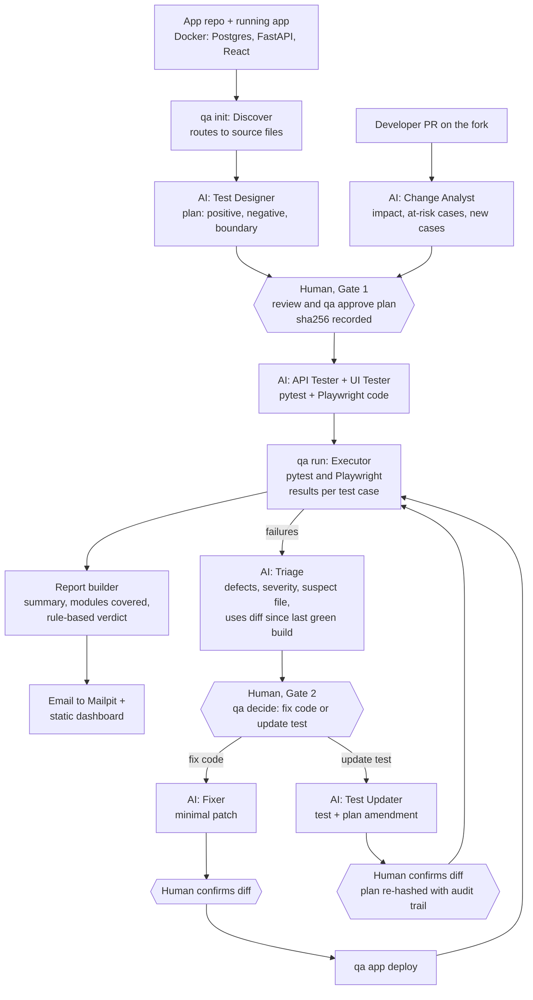

# Architecture: agent workflow

Design principle: **the Python CLI owns everything deterministic** (state, gates, execution, reporting, deployment),
and **agents own only creative judgment** (what to test, what the test code is, why a test failed, what the fix is).
Agents never run commands or edit files themselves. They receive text, return text or JSON, and Python validates and
writes the result. Humans approve at two gates, and the code enforces them.

## Agents

| Agent (file in `.claude/agents/`) | Role | Inputs | Outputs | Human review |
|---|---|---|---|---|
| `test-designer` | Generate scenarios and test cases for the flow | endpoint list and UI routes discovered from the repo | `test_cases.json` (id, layer, type, priority, target module, steps, expected) | Gate 1 |
| `api-tester` | Write API tests (status, schema, auth, errors, validation) | approved API cases, fixtures source, route/model source | pytest files in `generated/api/` | code reviewed in repo; Gate 1 on the cases |
| `ui-tester` | Write E2E UI tests | approved UI cases, helper source, frontend source, template's own Playwright tests as selector reference | Playwright specs in `generated/ui/` | same |
| `triager` | Classify failures (product bug, test issue, environment), rank severity, name the suspect module | failing tests with errors and test source, plan entries, app diff since the last green build, suspect source | `defects.json` and `defects/DEF-xxx.md` | Gate 2 |
| `fixer` | Fix a confirmed product bug | defect, suspect file in full, regression diff | patch to app files, committed on the branch | human confirms the diff |
| `test-updater` | Update an outdated test and its plan entry | defect, failing test file in full, plan entries, intended-behavior diff | updated test file, `plan_update.json` | human confirms the diff; plan re-approved with audit trail |
| `change-analyst` | Keep tests current with developer PRs | PR title, description, diff, changed source, current plan | `plan_delta.json`, new cases appended to the plan (at most 1 per layer) | Gate 1 again |

Tools: local Claude Code CLI (`claude -p`, tools disabled, session isolated), pytest + httpx, Playwright (Chromium),
Docker Compose, Git and GitHub CLI, Mailpit (SMTP capture), plain HTML for report and dashboard.

## Deterministic stages (no AI)

| Stage | Command | What it guarantees |
|---|---|---|
| Discover | `qa init` | maps every endpoint to its source file, which powers failure attribution |
| Gate enforcement | `qa run`, `qa generate` | refuse unless the approved plan hash matches the current plan |
| Execute | `qa run` | one run folder per execution; results keyed by test-case id |
| Verdict | `qa run`, `qa report` | No-Go if any P1 fails, any open Sev1/Sev2 defect, or pass rate under 90%; Go with risks if only lower-priority failures or skips; otherwise Go |
| Defect lifecycle | `qa run` | a defect is closed automatically when the next run passes all its tests |
| Report | `qa report`, `qa email` | per-run HTML with suite totals, modules covered, failing modules, defects, trend |

## Guardrails against agent mistakes

- Coverage check: generation fails if a test references an id not in the approved plan, or an approved case has no test.
- Write scope: agents can only write inside `generated/` (tests) or `backend/`, `frontend/src/` (fixes); incremental
  generation must create exactly one new file and may not overwrite existing tests.
- Syntax check on proposed Python fixes before they are written.
- The test-updater may not add or remove test cases; the set of case ids in a file must be unchanged.
- Every proposed fix or test change is shown as a diff and needs explicit confirmation.
- The plan hash changes force re-approval, so approved scope cannot drift silently.
